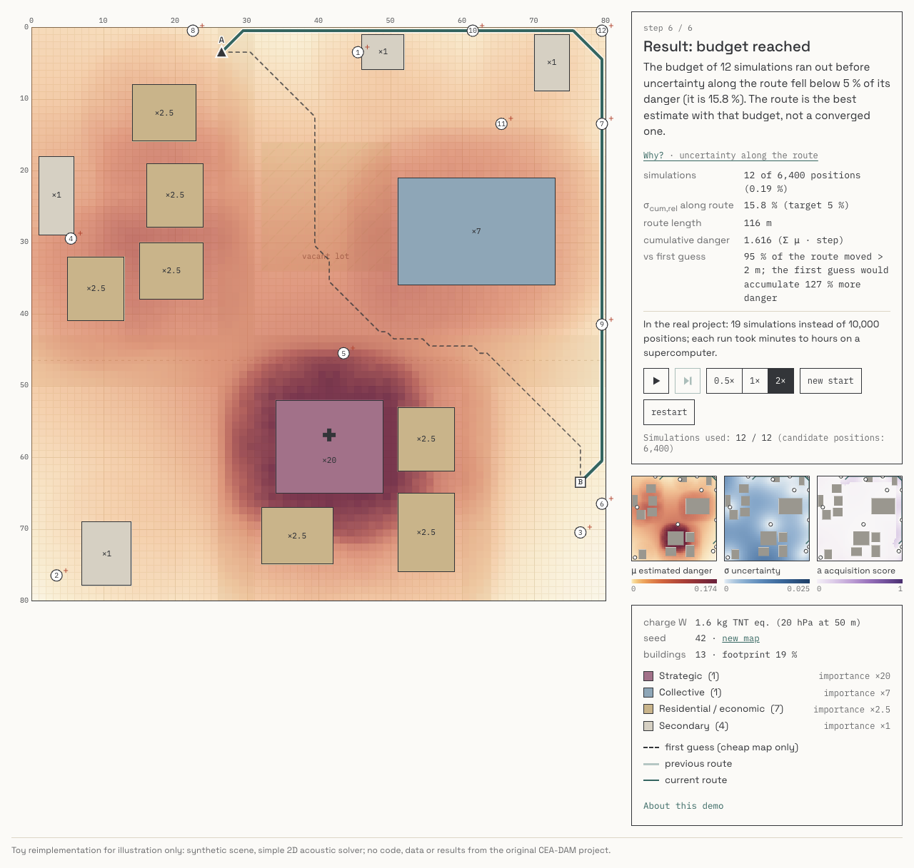
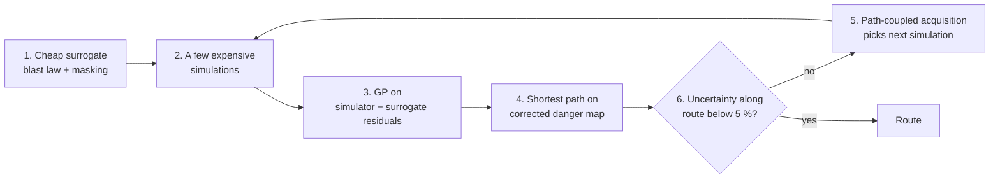

# Blast-aware route planning — interactive toy demo

Find the route for moving a device that may detonate from where it was found (A) to a disposal site (B) so that an accidental detonation along the way would do as little damage as possible to the buildings nearby. Only a handful of expensive simulations are run, and Bayesian optimization chooses where.

**[▶ Live demo](https://tancredea.github.io/projects/blast-routing/simulation/)** · **[Project page & report](https://tancredea.github.io/projects/blast-routing/)**

[](https://github.com/tancredea/blast-routing-demo/actions/workflows/test.yml)



> **This is a toy.** It reimplements, from scratch and with public equations only, the method of a confidential academic project carried out with CEA-DAM. The original code ran only on CEA-DAM's supercomputer around its proprietary simulator ARMEN, so it can be neither published nor run elsewhere. Here a simple 2D acoustic solver replaces ARMEN; **the procedure around it is the same**. Not affiliated with or endorsed by CEA-DAM.

## Why this repository exists

*Optimal Routing under Blast-Exposure Constraints* (CentraleSupélec × CEA-DAM, 2026) was built around ARMEN, CEA-DAM's proprietary high-fidelity hydrodynamics code, and around the cluster it runs on. That code is covered by a confidentiality agreement, and outside that environment it would not run anyway. This repository rewrites the method from scratch so that anyone can read it, run it in a browser and test it, while the original stays confidential. For the full context, my role and the public report, see the [project page](https://tancredea.github.io/projects/blast-routing/).

## The method in one picture



## Real project vs this toy

| Component | Real project | This demo |
|---|---|---|
| Expensive simulator | ARMEN (CEA-DAM), compressible hydrodynamics, HPC | 2D linear acoustic FDTD, in a Web Worker |
| Cheap surrogate | Kingery–Bulmash-type fit + building masking | Kinney–Graham law + ×0.8 per building in the way |
| Correction | GP on residuals, Matérn 5/2 + nugget | Same |
| Path search | Delta-Stepping (2D), direction-aware A* (3D) | Delta-Stepping |
| Acquisition and stop | Path-coupled corridor rule, σ_cum,rel < 5 % | Same, with a 12-simulation budget |
| Scale | 100 × 100 m, 10,000 positions; 3D on a supercomputer | 80 × 80 m, 6,400 positions, 2D, in the browser |

Only the oracle and the scale change; the decision procedure — what to simulate next and when to stop — is the one used in the project.

## Step by step

The visitor makes exactly one choice: where the device was found. Everything else is generated or computed, deterministically from `?seed=`.

| Step | On screen | Real-pipeline counterpart |
|---|---|---|
| 0. Scene | 80 × 80 m peri-urban block, 10–14 buildings in 4 ICPE categories (importance ×1, ×2.5, ×7, ×20), B = the point farthest from any building | 2D city block, criticality weights d_k |
| 1. Cheap estimate | Danger map from an empirical blast law (Kinney–Graham, a Kingery–Bulmash-type scaled-distance law), ×0.8 per building in the way; dashed first-guess route | KB surrogate with building masking |
| 2. Simulations | 5 space-filling shots of a 2D acoustic wave solver, with the wave animated over the map | High-fidelity hydrodynamics runs |
| 3. Correction | Gaussian process (Matérn 5/2 + nugget, ML hyperparameters) on simulator − KB residuals; mini-maps μ, σ and acquisition score | GP on residuals |
| 4. Route | Delta-Stepping on the corrected map, animated bucket by bucket; the previous route stays as a ghost | Delta-Stepping |
| 5. Next point | 5 m corridor around the route; acquisition a = 0.7·σ/maxσ·1_C + 0.3·(σ/μ)/max; the winner is simulated next | Path-coupled active acquisition |
| 6. Result | Simulations used, σ_cum,rel, route length, cumulative danger, change versus the first guess | 19 runs instead of 10,000 positions |

The loop stops when σ_cum,rel = Σ_C σ / Σ_C μ < 5 % over the corridor, or after 12 simulations (5 initial + up to 7 acquisitions). If the budget runs out first, the result card says so.

## Run it locally

The page uses ES modules and Web Workers, which browsers block over `file://`. From the repository root:

```bash
python3 -m http.server 8000
```

then open <http://localhost:8000/>. Useful URL parameters:

- `?seed=42`: a reproducible map (without it, a random seed is drawn and written back into the URL);
- `?theme=light` or `?theme=dark`: force a theme (the default follows `prefers-color-scheme`).

Keyboard: arrow keys move a cursor on the focused map and Enter places the device; Space plays or pauses and → steps when the map is not focused. Before a spot is chosen, the play button starts from a suggested one. "new start" draws a new random map (new seed, same generation rules) and asks for a new start; "restart" replays the same map and start.

## Tests

From the repository root, with Node ≥ 20 and no install step:

```bash
node --test tests/*.test.js
```

The same files also run in a browser, which is handy without Node: serve the repository as above and open <http://localhost:8000/tests/run.html>. An import map points `node:test` and `node:assert/strict` at two small shims in `tests/shim/`.

The tests cover:
- the blast law against its reference values, and the charge W;
- g(p);
- the scene rules (footprint, category counts, connectivity, open area, B);
- FDTD stability, free-field calibration (±15 %) and wall shadowing;
- the GP (interpolation, σ near the data and far from it, ℓ inside its bounds);
- Delta-Stepping against Dijkstra on 50 random grids;
- the acquisition masks and the stopping rule;
- a headless end-to-end run on seed 42, with the performance budget (KB map ≤ 2 s, one shot ≤ 0.5 s).

GitHub Actions runs the same command on every push and pull request (`.github/workflows/test.yml`, Node 20).

## Files

```
index.html, style.css     page and theme tokens (all colours are CSS custom properties)
js/main.js                state machine, controls, narration wiring
js/rng.js                 mulberry32, URL seed
js/scene.js               generator, distance transform, B, facade probes
js/scoring.js             g(p), d_k, S(x)
js/kb.js, kb.worker.js    blast law + masking; KB map in a worker
js/fdtd.js, fdtd.worker.js  staggered-grid acoustic solver, calibration; shots in a worker
js/gp.js                  Matérn 5/2, Cholesky, grid-search MLE, posterior
js/path.js                Delta-Stepping (with exploration trace), Dijkstra
js/acquisition.js         corridor, acquisition score, stopping rule
js/pipeline.js            glue shared by the page and the headless test
js/render.js              canvas layers, colour ramps, mini-maps, legends
js/narration.js           step texts
fonts/                    Space Grotesk, IBM Plex Mono (SIL OFL)
tests/                    node --test files, browser runner and shims
```

Data layout: every map is a row-major typed array of 80 × 80 cells (cell = y·80 + x, 1 m, centre at x + 0.5, y + 0.5). The math modules are pure and DOM-free, so the same code runs in the workers, on the main thread and in Node.

Weight: about 117 KB of HTML, CSS and JS, plus about 50 KB of fonts. No dependencies, no build step, works offline once loaded.

## Modelling choices that differ from the brief, and why

- **FDTD calibration curve instead of a single scale factor.** With one factor (√(r_ref/r) spreading correction, least squares on log p over 3–40 m), the free field misses the blast law by up to 71 % near the source (ratio 0.29 at 3 m, 0.53 at 5 m, ≈ 1.0 beyond 12 m). The linear solver has no shock, so its decay is much flatter than the blast law's near field. The demo therefore divides each peak by the empty-domain peak at the same distance and multiplies by the blast law, which leaves a free-field error of 5.4 %. Open space then matches the cheap model, and the GP only learns reflections, diffraction and shadows. The single-factor mode is still in `fdtd.js` (`CAL_MODE = 'scalar'`).
- **Convergence is rarely reached within 12 simulations.** On seeds 1, 2, 3, 42 and 77, σ_cum,rel at 12 simulations is 15 %, 15 %, 18 %, 23 % and 43 %, and it plateaus around 7–16 % even with 24. The demo keeps the 5 % / 12 rule from the brief and says plainly when the budget ends the run.
- **Initial design** is greedy maximin over free cells at least 3 m from the border, the same restriction as for B. Without it, maximin puts points in the corners.
- **Layout retries** use seeds drawn from a stream derived from the requested seed, rather than seed + 1, so that neighbouring seeds don't produce the same map.
- **Routes may hug the map edge.** Danger is lowest far from buildings and the edge weight is μ·d with μ ≥ 10⁻³, so a long detour along the border is often genuinely cheaper.

## Embedding

The demo posts its height to the parent page, so an iframe can fit it at any width:

```html
<iframe id="blast-demo" src="https://tancredea.github.io/projects/blast-routing/simulation/?theme=light"
        title="Blast-aware route planning, interactive demo"
        loading="lazy" style="display:block;width:100%;height:960px;border:0"></iframe>
<script>
  addEventListener('message', e => {
    const f = document.getElementById('blast-demo');
    if (f && e.source === f.contentWindow && e.data && e.data.type === 'blast-demo:height') f.style.height = e.data.height + 'px';
  });
</script>
```

This is how it is embedded on the [demo page](https://tancredea.github.io/projects/blast-routing/simulation/).

## Credits

- Demo: Tancrède Amiel.
- Original project: a team of six CentraleSupélec students, with technical and scientific supervision from CEA-DAM and an academic referent at CentraleSupélec. The [project page](https://tancredea.github.io/projects/blast-routing/) has the details.
- Fonts: Space Grotesk and IBM Plex Mono (SIL OFL, licenses in `fonts/`).

## Disclaimer

Toy reimplementation for illustration only. The original project used ARMEN, a high-fidelity hydrodynamics code from CEA-DAM, on a supercomputer. Here a simple 2D acoustic solver plays that role. No code, data or results from the original project are used. The scenario (moving an unexploded device to a disposal site) is a motivating example. The scene is synthetic and randomly generated. Not affiliated with or endorsed by CEA-DAM or CentraleSupélec.

## License

Code: [MIT](LICENSE). Fonts: their own SIL Open Font License files in `fonts/`.
